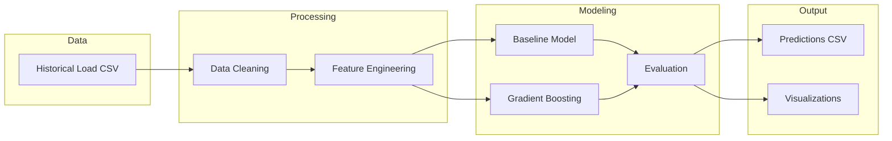

# Energy Demand Forecasting ML

> End-to-end electricity load forecasting system using time-series analysis and machine learning.

## Overview

This system predicts electricity demand using historical consumption patterns, enabling utility companies to optimize generation capacity and grid stability. The solution combines feature engineering, machine learning models, and visualization for operational decision support.

## Architecture



## Features

- **Data preprocessing**: Missing value handling, outlier detection
- **Feature engineering**: Cyclical encoding, lag features, rolling statistics
- **Multiple models**: Baseline (moving average), Gradient Boosting
- **Evaluation**: MAE, MAPE, RMSE metrics with visualizations
- **Forecasting**: Generate predictions for future time periods

## Project Structure

```
├── data/
│   └── sample_load_data.csv      # Sample electricity load data
├── src/
│   ├── data_preprocessing.py     # Data cleaning and preparation
│   ├── feature_engineering.py    # Feature creation utilities
│   ├── models.py                 # Model training and prediction
│   └── evaluation.py             # Metrics and visualization
├── notebooks/
│   └── exploration.ipynb         # Data exploration notebook
├── main.py                       # Main pipeline script
├── requirements.txt              # Python dependencies
└── README.md
```

## Quick Start

```bash
# Install dependencies
pip install -r requirements.txt

# Run the forecasting pipeline
python main.py

# Or run with custom data
python main.py --data path/to/your/data.csv
```

## Sample Output

```
============================================================
Energy Demand Forecasting Pipeline
============================================================

Loading data...
✓ Loaded 8760 hourly records

Preprocessing...
✓ Handled 12 missing values
✓ Removed 3 outliers

Feature Engineering...
✓ Created 15 features (temporal, lag, rolling)

Training Models...
✓ Baseline Model: MAE = 245.3 MW
✓ Gradient Boosting: MAE = 142.7 MW

Generating Forecasts...
✓ 24-hour ahead predictions saved to output/predictions.csv
✓ Visualizations saved to output/plots/
```

## Results

| Model | MAE (MW) | MAPE (%) | RMSE (MW) |
|:------|:---------|:---------|:----------|
| Baseline (7-day MA) | 245.3 | 8.2% | 312.1 |
| Gradient Boosting | 142.7 | 4.8% | 198.4 |

## Tools & Technologies

`Python` `Pandas` `Scikit-learn` `NumPy` `Matplotlib` `Time Series Analysis`

---

*Built by Aimal Khan — Data Engineer & Automation Specialist*
